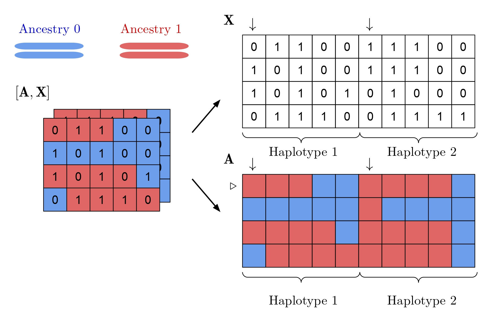

# Efficient algorithms for exact and approximate enumeration of admixed arrays

Admixed arrays are discrete structures arising from analyses of genetically admixed populations, and are closely related 
to binary matrices. **zagar** is a software that allows the user to compute the cardinality of constrained sets 
of admixed arrays. These constraints include individual global ancestry proportions (a row sum constraint) and 
ancestry-specific allele frequencies (a column sum constraint). Analytically derived approximate counts are provided for 
a special semi-regular constraint.  

	

## Project Website

Installation instructions, tutorials and API documentation can be found here:
	
	https://alanaw1.github.io/zagar
	

## License

Our software carries a [GPL-3.0](https://www.gnu.org/licenses/gpl-3.0.en.html) license. 

Our project website carries a [CC BY 4.0](https://creativecommons.org/licenses/by/4.0/) license.
